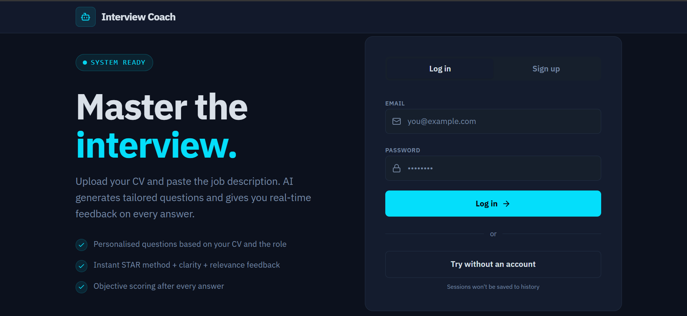
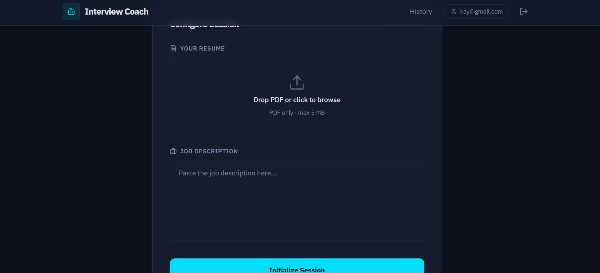
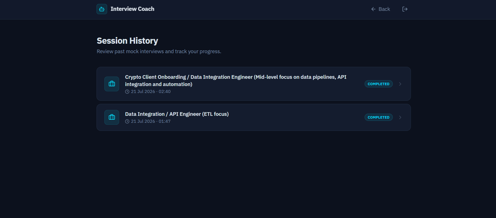
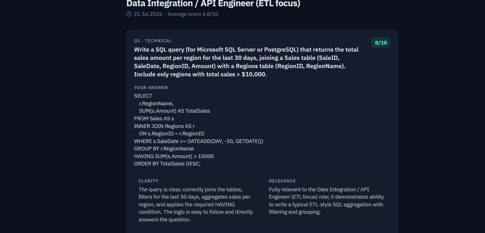

# AI Job Interview Coach — Frontend

Upload a CV (PDF) and paste a job description; the app generates a personalized 8-question
mock interview, runs it as a chat with live scoring and follow-up questions, and (per the
backend contract) produces a final AI-written readiness report.

This is the frontend only — it calls a separate FastAPI backend over HTTP and does not
implement any AI/business logic itself. Backend: `ai-interview-coach-backend`, deployed at
`https://ai-interview-coach-backend-g522.onrender.com` (free tier — spins down after 15 min
idle, first request after that can take up to ~60s to wake up).

## Live demo

- **App:** https://ai-interview-coach-frontend.kariniskandarani2000.workers.dev/
- **Walkthrough:** https://ka.nz/ai/kariniskandarani

The backend runs on Render's free tier, so the first request after idle can take up to a minute.

## Screenshots

| Login | Upload CV + job description |
|---|---|
|  |  |

| Session history | Past interview detail |
|---|---|
|  |  |

## Stack

- **Frontend:** Vite + React + TypeScript, routing with `wouter`, Tailwind CSS v4, shadcn/ui
  (Radix), framer-motion, TanStack Query
- **Auth:** Supabase Auth (email/password + guest mode) via `@supabase/supabase-js`
- **Backend:** separate FastAPI service, called directly with `fetch()` (no intermediate API layer)
- **Hosting:** Cloudflare (frontend), Render (backend)
- **Tooling:** pnpm workspace; the app lives at `artifacts/interview-coach/`

## How it was built

Built with AI coding tools (Claude Code, and Replit's AI Agent for the initial scaffold).
The prompts that drove each feature pass are kept in [`docs/prompts/`](docs/prompts/) as a
build log and spec history. Replit-specific tooling and unused template scaffolding have since
been removed.

## Prerequisites

- Node.js 24
- pnpm — this repo requires pnpm specifically (a preinstall check rejects `npm`/`yarn`). If you
  don't have it: `npm install -g pnpm`

## First-time setup

```sh
pnpm install
```

> **Windows note:** `pnpm-workspace.yaml` excludes some platform-native binaries (`esbuild`,
> `rollup`, `lightningcss`, `@tailwindcss/oxide`) via `overrides` to keep the lockfile lean. The
> `win32-*` lines have been removed so `pnpm install` also pulls the Windows binaries.
>
> The first install may also prompt about ignored build scripts — run `pnpm approve-builds --all`
> if so, then `pnpm install` again.

## Environment variables

Supabase Auth credentials are required (email/password login + a "Try without an account" guest
path). Copy the example file and fill it in:

```sh
cp artifacts/interview-coach/.env.example artifacts/interview-coach/.env
```

`.env` is git-ignored — ask whoever has the Supabase project access for the actual
`VITE_SUPABASE_URL` / `VITE_SUPABASE_ANON_KEY` values (publishable/anon key, safe client-side).

The backend URL is hardcoded in `artifacts/interview-coach/src/lib/api.ts`, no env var needed.

## Running the dev server

From `artifacts/interview-coach/`:

```sh
pnpm dev
```

Then open `http://localhost:5173`. `vite.config.ts` defaults `PORT` to `5173` and `BASE_PATH` to
`/` — only set those as real shell env vars if you need to override them (they're read before
`.env` loading happens, so they can't go in the `.env` file).

## Other commands

- `pnpm run typecheck` — typecheck across all workspace packages
- `pnpm run build` — typecheck + build all packages
- `pnpm --filter @workspace/interview-coach run build` — build just the frontend app

## What's implemented

Based on the prompts in `docs/prompts/`, which are the source-of-truth
spec for each feature pass:

- ✅ Core upload → interview → chat flow (`docs/prompts/01-frontend.md`)
- ✅ Visual polish pass (`docs/prompts/02-visual-polish.md`)
- ✅ Resume-on-refresh + Past Interviews history page (`docs/prompts/03-history-and-resume.md`)
- ✅ Supabase Auth: login/signup + "Try without an account" guest mode (`docs/prompts/04-auth.md`)
- ❓ UX polish pass (`docs/prompts/05-ux-polish.md`) — not verified
- ❓ Sizing/refinement pass (`docs/prompts/06-sizing-refinement.md`) — not verified
- ✅ Final AI-written readiness report (`docs/prompts/07-report-feature.md`) — `getReport()` call
  to `/api/sessions/{id}/report` and a full report view (score gauge, summary, strengths,
  weaknesses, study plan) in `Interview.tsx`

Re-verify this list against the code before relying on it — it reflects a point-in-time check,
not a maintained status.
